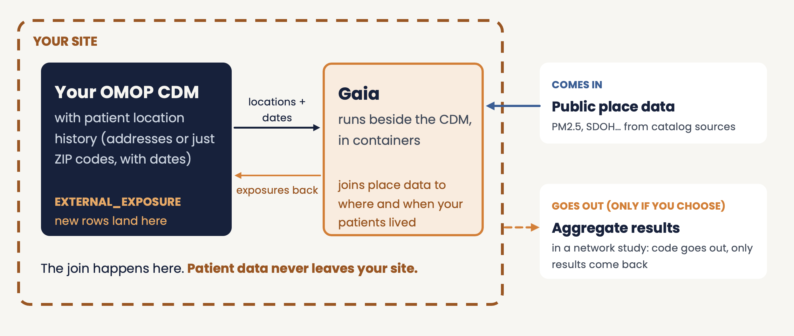

# **Architecture & Data Flows**

This page describes the technical architecture of the Gaia toolchain, including component interactions, data flows, and design principles.

<br>

## **System Architecture Overview**

The Gaia toolchain consists of multiple interconnected components that work together to integrate geospatial data with the OMOP Common Data Model.

### **High-Level Architecture**

```
┌─────────────────────────────────────────────────────────────────┐
│                    External Data Sources                         │
│  (Census, EPA, Weather, Social Services, Geographic Boundaries)  │
└────────────────────────────┬────────────────────────────────────┘
                             │
                             ▼
┌─────────────────────────────────────────────────────────────────┐
│                       gaiaCatalog                                │
│  • Data source discovery                                         │
│  • Metadata (JSON-LD) and ETL scripts per dataset                │
│  • Schema.org compliance                                         │
└────────────────────────────┬────────────────────────────────────┘
                             │
                             ▼
┌─────────────────────────────────────────────────────────────────┐
│                        gaiaDB                                    │
│  • PostgreSQL/PostGIS database                                   │
│  • Catalog-driven ingestion (ETL scripts)                        │
│  • Geometry-attribute index                                      │
│  • Per-source geometry and attribute tables                      │
└────────────────────────────┬────────────────────────────────────┘
                             │
                             ▼
┌─────────────────────────────────────────────────────────────────┐
│                       gaiaCore                                   │
│  • R package (direct database connection)                        │
│  • Pipeline: ingestion, locations, spatial-temporal join         │
│  • Quality checks, copy into the OMOP CDM                        │
│  • Exposure analytics                                            │
└────────────────────────────┬────────────────────────────────────┘
                             │
                             ▼
┌─────────────────────────────────────────────────────────────────┐
│                  OMOP CDM + GIS Extensions                       │
│  • Location_History table                                        │
│  • External_Exposure table                                       │
│  • Integrated with standard OMOP tables                          │
└────────────────────────────┬────────────────────────────────────┘
                             │
                             ▼
┌─────────────────────────────────────────────────────────────────┐
│                     HADES Analytics                              │
│  • Cohort definition                                             │
│  • Patient-level prediction                                      │
│  • Population-level estimation                                   │
│  • Evidence generation                                           │
└─────────────────────────────────────────────────────────────────┘
```

<br>

## **Component Details**

### **1. gaiaCatalog**

**Purpose**: Data source discovery and metadata management

**Technology**: Schema.org JSON-LD (Science on Schema.org profile), KoboToolbox authoring with SSSOM mapping, SHACL validation, optional Solr search index

**I/O**: External data URLs/metadata → Catalog entry (JSON-LD metadata plus the ETL scripts that retrieve and load the dataset)

<br>

### **2. gaiaDB**

**Purpose**: Core data repository with all geospatial processing logic and OMOP integration

**Technology**: PostgreSQL/PostGIS (the reference image uses PostgreSQL 16 with PostGIS 3.5); PostgREST optional

**Processing**: SQL routines, PostGIS functions, spatial-temporal joins and temporal alignment. Every source is registered in the geometry-attribute index (`geom_index`, `attr_index`) so the same join serves all of them. The index covers vector geometries today.

**I/O**: Catalog entries + person locations and residence histories → `working.external_exposure` (copied into the CDM's EXTERNAL_EXPOSURE by gaiaCore)

**Schemas**: `backbone` (metadata, indexes, ingestion and catalog functions), `working` (locations, per-source geometry and attribute tables, exposures), `vocabulary` (OMOP vocabulary tables), `public` (raw source tables loaded by each dataset's ETL scripts)

<br>

### **3. gaiaCore**

**Purpose**: R interface to gaiaDB: runs the pipeline, checks the derived exposure and provides exposure analytics (no spatial processing logic of its own)

**Technology**: R package using DatabaseConnector (JDBC); Docker image `ohdsi/gaia-core` (HADES + gaiaCore)

**I/O**: Catalog dataset ids, person locations → gaiaDB functions → exposure rows → OMOP `EXTERNAL_EXPOSURE`, summaries and estimates in R

**Key**: gaiaCore calls gaiaDB's SQL functions. All spatial processing happens in gaiaDB. The Python, Java, Julia and Bash clients and the PostgREST-based R client live on the gaiaCore `connectors` branch.

<br>

## **Data Flow Details**

### **End-to-End Data Flow**

#### **Phase 1: Data Discovery**
```
External Source → gaiaCatalog
    Input: Dataset URL, documentation
    Process: Metadata extraction, cataloging
    Output: Cataloged data source with metadata
```

#### **Phase 2: Data Ingestion**
```
Cataloged Source → gaiaDB
    Input: Raw geospatial files (retrieved by the entry's ETL scripts)
    Process: Metadata load, download and load into PostGIS, geometry clean-up, registration in the index
    Output: Per-source geometry and attribute tables (vector sources)
```

#### **Phase 3: Exposure Calculation**
```
Patient Locations → gaiaDB (loaded and joined from R with gaiaCore)
    Input:
        - Patient geocoded addresses
        - Residence time periods
        - Variable specifications
        - Location_History records
    Process (in gaiaDB):
        - Spatial joins (PostGIS)
        - Temporal alignment (SQL)
        - Each value clipped to the residence interval
        - No addresses leave the site
    Output:
        - External_Exposure records
```

#### **Phase 4: OMOP Integration**
```
gaiaDB Output → OMOP CDM
    Input: Processed exposure data
    Process:
        - Map to OMOP vocabulary concepts
        - Link to Location table (privacy-preserved)
        - Link to Person via Location_History
        - Populate External_Exposure table
    Output: OMOP CDM with integrated geospatial exposures
```

#### **Phase 5: Analytics**
```
OMOP CDM + GIS Extensions → HADES
    Input: Integrated clinical + geospatial data
    Process: Standard OHDSI analytics
    Output: Evidence generation
```

<br>

## **Privacy Architecture**

Gaia enables geospatial analysis **without sharing sensitive patient addresses**. It runs beside the CDM, inside the data holder's site:

1. **Geocoding at site** - Addresses are geocoded locally (or the site starts from ZIP codes or tracts it already holds)
2. **Locations and dates in, exposures back** - Gaia joins public place data to where and when patients lived, inside the site; new rows land in EXTERNAL_EXPOSURE
3. **Nothing identifying leaves** - Addresses, coordinates and location histories stay in the site's enclave. In a network study, code goes out and only aggregate results come back, and only if the site chooses
4. **Locations stay protected** - A home location is identifying even without a name, so the location tables stay inside the protected environment



**Workflow**: Raw address (protected) → Geocode locally → Locations and dates to Gaia → Exposures back to the CDM → Aggregate results (optional)

Containerization helps keep geospatial processing separate from protected clinical systems, but it is not sufficient on its own: institutional governance, data-flow controls and local review remain required.

<br>

## **Design Principles**

1. **Separation of Concerns**: gaiaCatalog (discovery), gaiaDB (processing), gaiaCore (access), gaiaDocker (deployment)
2. **Standards**: OMOP CDM, Schema.org, OGC geospatial, OHDSI vocabulary
3. **Privacy**: No PHI sharing, local geocoding, patient locations stay in the site's enclave
4. **Modularity**: Independent components, clear interfaces, pluggable sources
5. **Reproducibility**: Version-controlled catalog entries, documented provenance, open source

<br>

## **Inputs and Outputs by Component**

### **gaiaCatalog**

| Input | Format | Output | Format |
|-------|--------|--------|--------|
| Dataset URL | String | Catalog entry | JSON-LD |
| Metadata | Schema.org | Searchable index | Database |
| Variables | CSV/JSON | Variable catalog | JSON |

### **gaiaDB**

| Input | Format | Output | Format |
|-------|--------|--------|--------|
| Shapefiles | .shp | PostGIS tables | SQL |
| GeoJSON | .geojson | Indexed geometries | PostGIS |
| Raster | .tif, .nc | Staging tables (registration in the index is planned) | PostGIS |
| CSV with coords | .csv | Point geometries | PostGIS |
| Catalog entry (ETL scripts) | JSON-LD, shell | Registered per-source tables | PostGIS |
| Patient locations and residence periods| Geocoded coords | External_Exposure | OMOP table |
| Variable IDs | Integer | Exposure values | Numeric |
| SQL function calls | SQL | Query results | Tabular |

### **gaiaCore**

| Input | Format | Output | Format |
|-------|--------|--------|--------|
| Catalog dataset ids | Character | Ingested datasets, variable tables | gaiaDB tables |
| Locations and residence histories | Data frames / OMOP tables | Loaded `working` tables | gaiaDB tables |
| Variable name, spatial operator | Function call | Exposure rows | `EXTERNAL_EXPOSURE` |
| Exposure rows, windows, outcomes | Data frames | Quality checks, windowed exposure, effect estimates | Data frames |
| Connection params | `connectionDetails` | Database access | JDBC connection |

### **gaiaDocker**

| Input | Format | Output | Format |
|-------|--------|--------|--------|
| docker-compose.yaml | YAML | Running containers | Docker services |
| Profile selection | CLI flag | Stack configuration | Deployed services |
| Environment config | .env | Service parameters | Runtime config |
| Component images | Docker | Orchestrated stack | Running Gaia toolchain |

<br>

## **OMOP Integration**

**Extension Tables**: Location_History (patient-location-time), External_Exposure (place-based exposures)

**HADES**: Standard packages work with extended CDM, cohort definitions can include exposure criteria

See [Schema Extensions](schema-extensions.html) for complete DDL.

<br>

## **Performance & Scalability**

- **Indexing**: GIST spatial indexes, materialized views
- **Caching**: Datasets, transformations, API responses
- **Scaling**: Connection pooling, batch processing; heavy work stays in gaiaDB
- **Join cost**: On the 40,000-person tract benchmark (2.9 million rows) the Gaia join took about 28 s, against 16-17 s for the equivalent hand-written PostGIS query (about 1.7 times as long), with identical rows. Its value is catalog-driven provenance, standardization and reuse, not speed.

See [Deployment Strategies](developer-deployment.html) for deployment options.

<br>

## **Future Enhancements**

**Planned**: Raster support in the index, geometry hierarchies and boundary validity periods, a declarative recipe layer (under evaluation), real-time data streams, ML integration, multi-site federation, enhanced catalog, unified API gateway

**Research**: Differential privacy, federated learning, spatiotemporal modeling

<br>
