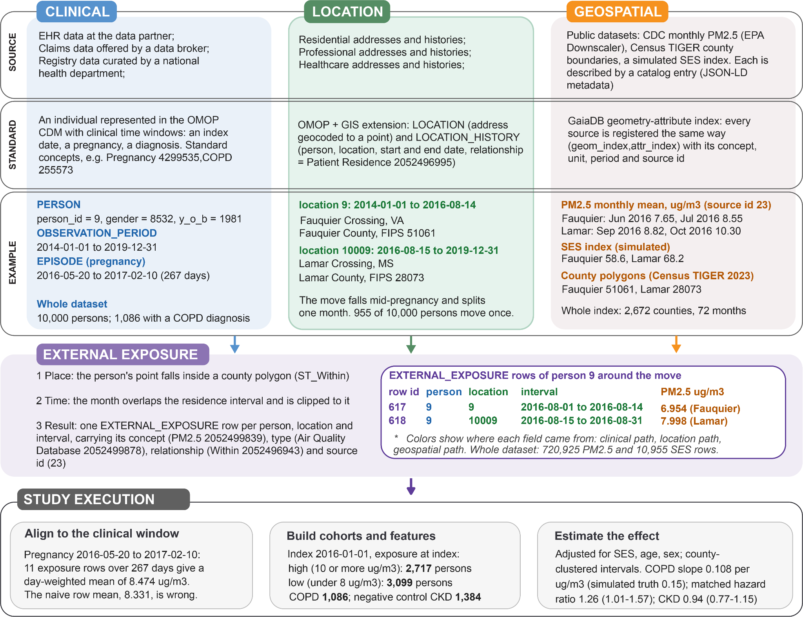
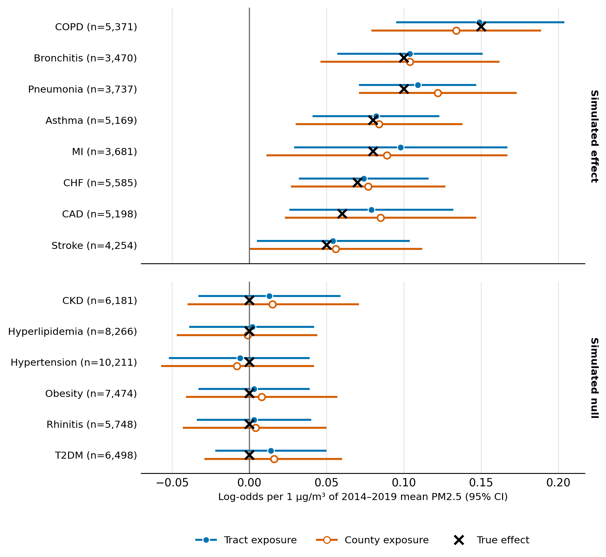

# **Evaluation on Synthetic Data**

Real patient addresses cannot be shared, and they are exactly the data a privacy-preserving, federated toolchain keeps local. The toolchain was therefore evaluated on synthetic OMOP CDM v5.4 cohorts, in which the true exposure, the true exposure-outcome effects and the true residence of every person are known. This page summarizes that evaluation, which is described in the accompanying manuscript. The code, generators, tutorial exercises and benchmark scripts are archived on Zenodo (version 1.0.1, release tag `benchmark-v1.0.1`, [10.5281/zenodo.23296292](https://doi.org/10.5281/zenodo.23296292)); the working copy is [`syntheticDataGIS/`](https://github.com/OHDSI/GIS/tree/main/syntheticDataGIS), and the benchmark scripts are described in its [`benchmark/README`](https://github.com/OHDSI/GIS/blob/main/syntheticDataGIS/benchmark/README.md).

**What it tests**: whether the pipeline reproduces the exposures and recovers the effects that were simulated, and how geocoding error propagates to exposure and effect estimates. **What it does not test**: privacy preservation (which rests on local execution), clinical prediction, or causal effects. No real individuals, addresses or coordinates are represented, and the effects are deliberately larger than published epidemiologic estimates: treat them as benchmark values, not effect sizes.

 

## **Two synthetic cohorts**

| | Tutorial cohort | Benchmark cohort |
|---|---|---|
| Persons | 10,000 adults | 40,000 adults (44,003 residence locations) |
| Geography | 2,672 U.S. counties | 10,223 census tracts in Alabama, Arizona, California and Oregon |
| Residences | about 10% move once | about 10% move once |
| Period | 2014-2019 | 2014-2019 |
| Resolution | county | tract (and county) |

Residences are random points inside real census units. Exposure is monthly PM2.5 from the CDC Environmental Public Health Tracking Network (EPA Downscaler estimates) at county and, for the benchmark, tract resolution, together with a simulated socio-economic status (SES) index that is correlated with PM2.5 and so confounds its association with outcomes. Fourteen conditions (five respiratory, nine cardiometabolic) were drawn from the derived exposures with a logistic model: eight carry a simulated PM2.5 effect (0.05 to 0.15 log-odds per µg/m³) and six are simulated nulls that serve as negative controls.

 

## **A worked example**

*Person 9 moves from Fauquier County, VA, to Lamar County, MS, midway through a pregnancy. A spatial join (ST_Within) and temporal clipping to the residence interval produce one EXTERNAL_EXPOSURE row per person, location and interval; the move splits August 2016 into two rows. Study execution then aligns the exposures to the clinical window (a day-weighted mean over 11 rows, 8.474 µg/m³, rather than the unweighted row mean, 8.331), builds cohorts and features, and estimates effects adjusted for SES, age and sex. All data are synthetic; estimates illustrate the workflow and are not findings.*

 

## **One index, several sources**

The sources of the evaluation differ in geometry, resolution, time coverage, origin and variable structure. All were registered through the geometry-attribute index and joined with the same function.

| Source | Role | Origin | Native structure | Time coverage | Registered in |
|---|---|---|---|---|---|
| US county boundaries (Census TIGER/Line 2023) | Geometry | Real | Polygons, about 3,100 counties | Static | `geom_index` |
| US census tract boundaries (TIGER/Line 2019; 2010 vintage) | Geometry | Real | Polygons, 11,523 eligible tracts in four states | Static | `geom_index` |
| Monthly PM2.5 at county and tract resolution (CDC EPHTN; EPA Downscaler) | Attribute (four variables; monthly mean joined) | Real | Monthly time series per unit | 2014-2019, monthly | `attr_index` |
| Simulated SES index (by county; by tract in the benchmark) | Attribute (confounder) | Simulated | One value per unit | Static | `attr_index` |
| US primary and secondary roads (TIGER/Line 2019) | Geometry | Real | Lines, 18,408 segments in four states | Static | `geom_index` |
| Simulated near-road increment (distance bands of 0-50, 50-100, 100-200 and 200-400 m around those roads) | Geometry and attribute | Simulated on real road geometry | Polygons, 140,832 pieces | Static | `geom_index` and `attr_index` |
| Simulated exposure surfaces (correlation length 100 m, 1 km and 10 km; 10 km window) | Geometry and attribute | Simulated | Polygons: 160,801, 1,681 and 25 cells | Static | `geom_index` and `attr_index` |

 

## **Results**

**Exposure derivation.** For the benchmark cohort, gaiaDB derived 2,883,882 tract-level and 2,883,882 county-level PM2.5 rows and 44,003 SES rows; for the tutorial cohort, 720,925 PM2.5 and 10,955 SES rows. The tract-level rows matched an independent answer key computed without any spatial operation (no missing or extra rows; maximum absolute difference below 10^-13), and a hand-written PostGIS query returned the same rows. The county-level rows matched for 39,997 of 40,000 persons; the other three live next to a county boundary where the tract (2019) and county (2023) boundary vintages disagree.

**Recovery of simulated effects.** Adjusted estimates from the continuous-exposure regression recovered the simulated effects. All 14 confidence intervals covered the true value, all 8 simulated effects were detected with tract exposure, and none of the 6 nulls was. For COPD the tract-level estimate was 0.149 log-odds per µg/m³ (95% CI 0.095 to 0.204) against a truth of 0.15. A crude model without SES adjustment was confounded (2 of 6 nulls flagged), as designed. County exposure is misclassified by design, because the generator draws exposure at tract level, and gave larger errors.

*Estimates and 95% confidence intervals (leave-one-county-out jackknife) from logistic regression of each outcome on day-weighted 2014-2019 mean PM2.5, adjusted for SES, age and sex, using tract (blue) or county (orange) exposure; crosses mark the simulated true effects. The six lower outcomes are simulated nulls.*

A CohortMethod comparison of high versus low exposure performed less well (adjusted intervals covered the truth for 6 of 8 effects with tract exposure and 4 of 8 with county exposure, and estimates were attenuated to roughly three quarters of the true effect because the exposure was dichotomized), so it is reported only as a qualitative check.

**Sensitivity to geocoding error.** Residences in 200 Monte Carlo replicates were displaced by a distance drawn from each geocoder's empirical error distribution (see [geocoding](geocoding.html)), reassigned to the containing tract and county, and all exposures and outcome models recomputed.

| Geocoder | Median error (m) | Assigned to another tract | Assigned to another county | Tract exposure RMSE, µg/m³ (correlation) | Mean / largest shift of the 14 estimates |
|---|---|---|---|---|---|
| Nominatim | 5.6 | 3.9% | 0.17% | 0.026 (0.9997) | 0.0007 / 0.0014 |
| ArcGIS Pro | 26 | 3.2% | 0.11% | 0.030 (0.9997) | 0.0005 / 0.0012 |
| DeGAUSS | 50 | 10.4% | 0.39% | 0.054 (0.9993) | 0.0018 / 0.0036 |
| PostGIS TIGER | 47 | 9.9% | 1.06% | 0.067 (0.9970) | 0.0016 / 0.0033 |

For a smooth regional exposure such as PM2.5, averaged over six years, realistic geocoding error changed person-level exposure little, and shifts in the effect estimates were smaller than their standard errors; no effect was lost or created.

**When geocoding error matters.** In two stress tests with the same persons, outcome model and error distributions, geocoding error mattered once it approached the length scale of the exposure. For synthetic exposure surfaces with an exponential correlation length of 100 m, 1 km or 10 km, the share of the true effect recovered fell as predicted by regression dilution:

| Correlation length | Nominatim | ArcGIS Pro | DeGAUSS | PostGIS TIGER |
|---|---|---|---|---|
| 100 m | 0.82 (56%) | 0.70 (27%) | 0.52 (7%) | 0.54 (7%) |
| 1 km | 0.95 (91%) | 0.96 (92%) | 0.87 (72%) | 0.87 (74%) |
| 10 km | 0.99 (93%) | 0.99 (93%) | 0.98 (93%) | 0.97 (93%) |

*Share of the true effect recovered (coverage of the 8 true effects). Coverage at the true locations was 94%, 93% and 93%.*

A near-road increment added to real tract PM2.5 behaved similarly: the near-road coefficient lost 4-6% with Nominatim and ArcGIS Pro and 14% with DeGAUSS and PostGIS TIGER, while the tract PM2.5 coefficient was unaffected. The road increments are illustrative, and synthetic residences lie farther from roads than real addresses, so the effect is likely understated. In both tests, Gaia joins of the surfaces and road bands reproduced the analytic values.

 

## **Limitations**

- No analysis was run across sites: federated execution is a property of the OHDSI network and of the design, not a result shown here.
- Patient locations were coordinates, not geocoded addresses, so geocoding was evaluated through simulated displacement rather than end to end.
- Persons are placed uniformly at random inside county or tract polygons, so everyone in a unit shares one exposure value; SES and SDOH values are simulated; null outcomes are null by construction.
- The index was exercised on a small set of source types: county and tract polygons, two area-level attribute sources, and, in the stress tests, simulated surfaces and road bands represented as vector polygons. It has not yet been exercised on native raster files, real high-resolution surfaces or point-monitor networks.
- The geocoding error distributions come from one urban county, so rural error is probably understated.
- Gaia-derived rows currently leave `unit_concept_id` empty; the unit is declared in the catalog (for example 32964, micrograms per cubic meter, for PM2.5).

Real-world, multi-site validation is a near-term priority.

 
