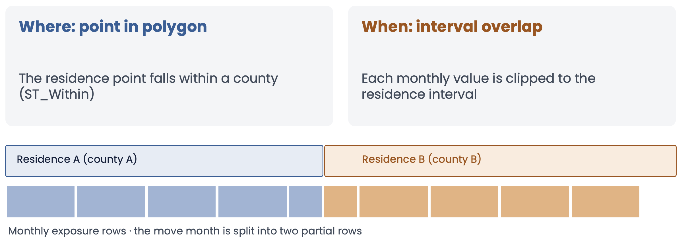
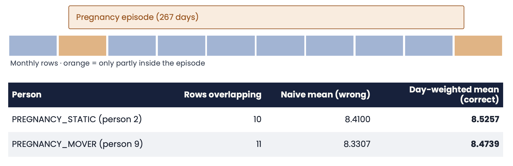
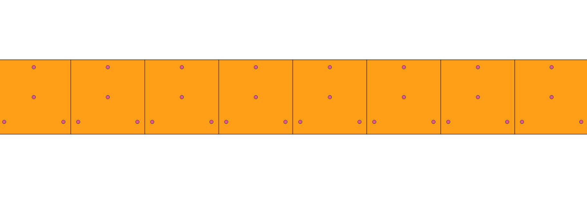
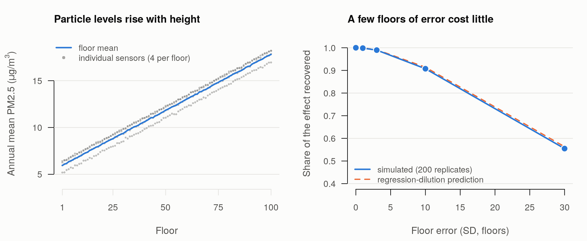

# **Examples**

Worked examples of what you can do with the Gaia toolchain. Each one states the question, the data, what Gaia does with it, and what you learn, and links to the materials to run it yourself. The examples use **synthetic persons** (no real individuals, addresses or coordinates) together with real or simulated place data, so every result can be checked against a known answer.

 

## **1. Long-term PM2.5 and COPD**

**Question.** Does long-term exposure to fine particulate matter relate to COPD?

**Data.** 10,000 synthetic adults placed at random points in real US counties, with residence histories (about 10% move once), 14 respiratory and cardiometabolic conditions and county-level social indicators. The exposure is real: monthly county PM2.5 from the CDC, 2014-2019. A simulated county SES index confounds the association.

**What Gaia does.**

1. Describe the PM2.5 source in a catalog entry and judge its fitness for the question
2. Ingest it and join it to the persons' residences: **where** (the residence point falls inside a county polygon) and **when** (each monthly value is clipped to the residence interval)
3. Land the result in the OMOP `EXTERNAL_EXPOSURE` table with standard concepts
4. Build exposure features and cohorts, and estimate the effect with HADES tools

**What you learn.** The exposure of a person who moves is the day-weighted mean over both residences, and a naive mean of the monthly rows is wrong:

Logistic regression of COPD on the 24-month day-weighted PM2.5 recovers a slope of about 0.11 per µg/m³ after adjustment (the simulated truth is 0.15), and the negative-control outcome (CKD) is about 0 once SES is in the model. A high-versus-low CohortMethod comparison gives a COPD hazard ratio of about 1.26 (1.01 to 1.57) and about 0.94 for CKD. The simulated effects are deliberately exaggerated: they are a teaching device, not real-world estimates.

**Run it.** [Tutorial](tutorial.html), with the SQL and R tracks, the [synthetic data description](tutorial-data-description.html) and the [answer key](tutorial-exercise-2.html).

 

## **2. Particle exposure by floor of a tall building**

**Question.** If the exposure changes with the floor you live on, how much does it matter when the floor is not known exactly?

**Data.** A synthetic 100-floor tower **flattened** to a row of 100 adjacent floor polygons (height is the x axis), with four particle sensors (points) on every floor, daily readings for a year, and 10,000 persons placed in different parts of the floors. PM2.5 rises with height by design (illustrative, not physical), and a person-level SES index that rises with the floor confounds the effect in the opposite direction to example 1.

*Eight floors in QGIS: each 30 m by 30 m floor is a polygon, with three sensors near the windows and one at the core.*

**What Gaia does.** The sensors become a point source and the floors a polygon source in the catalog. Each person's exposure is the floor mean of the sensors, joined by point-in-polygon and clipped to the residence interval, 365 daily rows per person and 3.65 million rows in all. They match an independent answer key exactly.

**What you learn.** A 2D geocoder does not know the floor. Because the gradient is smooth, an error of a few floors costs almost nothing, and it takes errors of about 10 floors to lose 10% of the effect. The loss follows the regression-dilution prediction closely. Grouping floors into zones (a Berkson-type error) loses little, whereas a random floor loses all of it, and without SES in the model the effects are biased down and the null outcomes look protective (the "penthouse" confounding).

**Run it.** [`syntheticDataGIS/tower`](https://github.com/OHDSI/GIS/tree/main/syntheticDataGIS/tower): generator, catalog entries, a check of the Gaia join against the answer key, and a loader that puts the floors, sensors and people in a running gaia-db so you can look at them in QGIS.

 

## **More examples**

More examples will be added here as they are ready. To propose one, or to bring a question of your own, see [Get Started](get-started.html#propose-a-use-case); the [use case and dataset status](status.html) page lists what the working group is working on.

 
