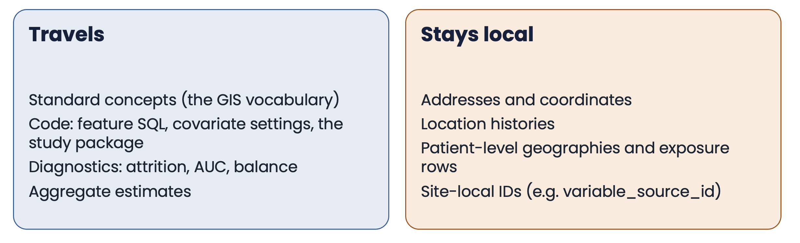
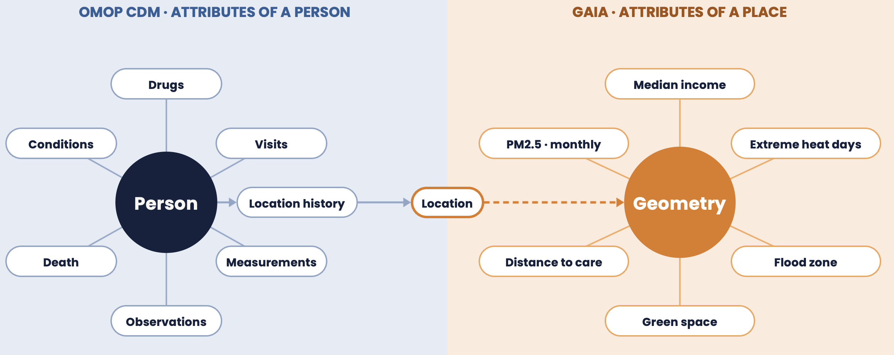
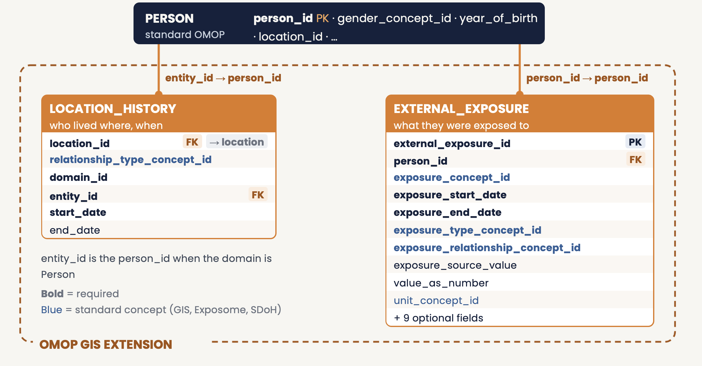
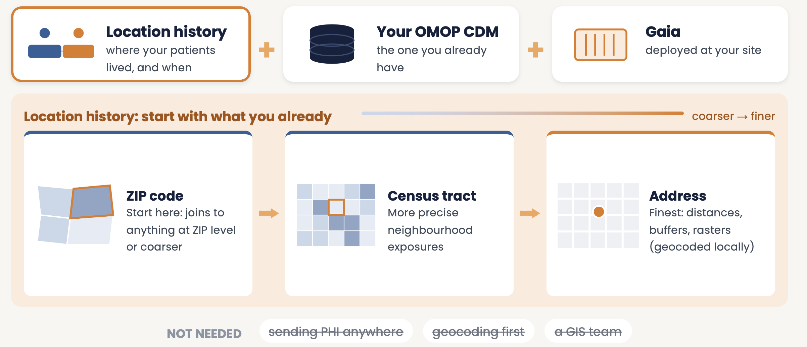

# **Gaia Toolchain**

## Introduction

**Gaia** is an integrated toolchain for combining geospatial data with OMOP Common Data Model (CDM) clinical data to enable population health research. Developed by the OHDSI GIS Working Group, Gaia provides infrastructure, software, standards, and workflows for integrating place-based datasets into patient-based health databases.

The name "Gaia" refers to the Greek personification of Earth, reflecting the toolchain's focus on place-based health determinants and the spatial context of human health.

### Mission

Improve the health of populations by generating reliable evidence from integrated geospatial and person-level health data.

### Current Scope

Gaia currently supports:

- **Geographic data sources**: Environmental exposures, social determinants of health, demographic data, infrastructure
- **Spatial data types**: Vector geometries are registered in the geometry-attribute index and joined to persons: polygons (census tracts, counties, grids), lines (roads) and points (facilities, monitoring stations). Raster sources (climate, pollution) can be staged, but registering them in the index is planned
- **Temporal coverage**: Historical and current datasets with versioning support
- **Catalog**: More than 100 curated datasets, described with schema.org JSON-LD
- **Geographic coverage**: Primarily US-focused with expanding international support
- **OMOP integration**: External_Exposure and Location_History extension tables
- **Privacy preservation**: Gaia runs beside the CDM, inside the data holder's site. Addresses and patient-level location histories stay there; only aggregate study results leave, and only if the site chooses

### Limitations

Current limitations being addressed:

- **Real-time data**: Limited support for streaming/real-time geospatial data (planned enhancement)
- **Rasters**: Raster sources are not yet registered in the geometry-attribute index (planned)
- **Recipes**: Retrieval and loading run as source-specific ETL scripts generated from each catalog entry; declarative recipes are being evaluated
- **Global coverage**: Majority of cataloged datasets focus on United States (expanding)
- **Vocabulary coverage**: Ongoing development of OMOP GIS, Exposome, and SDoH vocabularies
- **Federated analytics**: Multi-site federation architecture in development
- **Machine learning**: Limited built-in ML capabilities (planned integration)

<br>

## Overview

Gaia consists of multiple interconnected components:

### **Core Infrastructure**

**[gaiaDB](gaiaDB.html)** - PostgreSQL/PostGIS database
- Core data repository with all geospatial processing logic
- SQL routines and PostGIS functions for spatial operations
- Geometry-attribute index: every source registered the same way
- OMOP CDM integration and exposure calculations
- JSON-LD metadata ingestion from the catalog

**[gaiaCore](gaiaCore.html)** - R package for the Gaia pipeline and exposure analytics
- Direct database connection with DatabaseConnector
- Runs ingestion, location loading and the spatial-temporal join from R
- Quality checks on derived exposure and copy into the OMOP CDM
- Exposure analytics (day-weighted windows, cluster-robust effect estimates)
- Calls functions defined in gaiaDB; no processing logic of its own

**[gaiaCatalog](gaiaCatalog.html)** - Metadata catalog
- Functional metadata for publicly-hosted geospatial datasets
- Schema.org-compliant dataset descriptions
- ETL instructions (generated scripts) for automated retrieval and loading
- Federated metadata sharing
- Version tracking for data sources

**[gaiaDocker](gaiaDocker.html)** - Deployment orchestration
- Coordinated image builds for entire Gaia stack
- Versioned releases with docker-compose profiles
- Integration with OHDSI Broadsea ecosystem
- Official deployment method for all environments

### **Vocabulary Resources**

**[OMOP GIS Vocabulary Package](vocabulary.html)** - Custom vocabularies
- OMOP GIS Vocabulary (geographic entities, spatial relationships)
- OMOP Exposome Vocabulary (environmental toxins, pollutants)
- OMOP SDoH Vocabulary (social determinants from ADI, AHRQ, COI, EJI, SEDH, SVI, SDG, SDOHO)
- Developed via Custom Vocabulary Builder (CVB)
- Delta files available in [TuftsCTSI/CVB](https://github.com/TuftsCTSI/CVB/tree/main/GIS/Ontology)

<br>

## Purpose

Gaia provides a **standardized, automated, reproducible, and shareable** means for integrating place-based datasets into longitudinal patient health databases.

**Key capabilities**:
- Harmonize disparate geospatial datasets into common format
- Link patient locations to environmental and social exposures
- Calculate spatiotemporal exposure metrics while preserving privacy
- Integrate exposures into OMOP CDM for analytics
- Enable federated network studies with reproducible workflows

<br>

## Use Cases

### **Single Researcher**

A researcher deploys gaiaDocker locally and gains immediate access to curated geospatial data sources:

```bash
docker compose --profile gaia up -d
```

They can now:
- Load harmonized datasets across multiple domains (environment, demographics, SDoH)
- Perform spatial joins and exploratory analyses
- Create visualizations and geospatial applications
- Access data via API or direct database connection

**Example**: Link air quality monitoring data (EPA) with social vulnerability index (CDC) to study environmental justice.

### **OMOP CDM Integration**

A researcher with an OMOP CDM database integrates geospatial exposures:

1. **Geocode patient addresses locally** using DeGAUSS or the PostGIS TIGER geocoder (both optional components, run locally; see the [geocoding guidance](geocoding.html))
2. **Spatial joins** via gaiaDB SQL functions link residence locations and dates to exposures
3. **Calculate exposures** for residence periods (e.g., average PM2.5 during pregnancy)
4. **Populate OMOP tables**: External_Exposure and Location_History
5. **Analytics** using standard HADES tools (cohort definitions, patient-level prediction, population-level estimation)

All processing happens inside your site, in gaiaDB, next to your CDM:
- Locations and dates go from the CDM to Gaia, and exposures come back to the CDM
- Addresses and location histories are never sent anywhere
- In a network study, code goes out and only aggregate results come back
- Standard OMOP privacy protections apply


**Example**: Calculate neighborhood deprivation index exposure during critical developmental windows for pediatric asthma cohort.

### **Federated Network Research**

Gaia enables reproducible workflows across OHDSI data networks:

1. **Package workflow** - Script entire pipeline from geocoding → exposure calculation → OMOP integration
2. **Containerize** - Deploy via gaiaDocker with versioned releases
3. **Distribute** - Ship to network sites with minimal configuration
4. **Execute** - Sites run standardized workflow locally
5. **Aggregate** - Combine summary statistics without sharing PHI

Every exposure row carries the identifier of the variable it came from, so each result can be traced to its source in the catalog.



**Example**: Multi-site study examining association between greenspace exposure and mental health outcomes across diverse urban environments.

<br>

# **Gaia Framework**

OMOP models people; Gaia models places. Each side has one anchor, and the patient's location history links them.





The Gaia Framework consists of three main components working together:

## **1. Catalog Layer**

**[gaiaCatalog](gaiaCatalog.html)** provides data discovery and metadata management:

- **Descriptive metadata**: Facilitates search and discovery of datasets
- **Functional metadata**: Machine-actionable ETL instructions
- **Schema.org compliance**: Standard metadata format for interoperability
- **Centralized repository**: Reduces duplication of ETL development effort
- **Version control**: Track dataset versions and transformation recipes

**Data flow**: External data sources → Catalog metadata → Automated ingestion

## **2. Core Layer**

**[gaiaDB](gaiaDB.html)** provides storage and processing:

- **Database**: PostgreSQL/PostGIS with a `backbone` schema (metadata and index) and a `working` schema (data and exposures)
- **Processing engine**: All SQL routines and PostGIS functions for spatial operations
- **Standardized format**: every source is stored as geometries and their attributes, registered in the geometry-attribute index
- **OMOP integration**: Direct integration with CDM extension tables
- **Optional API**: gaiaDocker can expose the database through a PostgREST service

**[gaiaCore](gaiaCore.html)** is the R interface to gaiaDB:

- **Pipeline**: ingests catalog datasets, loads locations and runs the spatial-temporal join from R
- **Direct connection**: DatabaseConnector opens a JDBC connection; there is no REST layer in between
- **Quality**: checks the derived exposure rows before they reach the CDM
- **Analytics**: day-weighted exposure windows and cluster-robust effect estimates
- **Docker image**: `ohdsi/gaia-core`, HADES with gaiaCore and the extension packages

**Data flow**: Raw geospatial data → gaiaDB processing → gaiaCore (R) → OMOP CDM → HADES analytics

## **3. Extension Layer**

Specialized functionality beyond core CRUD operations:

- **Visualization**: Spatial data visualization tools (gaiaVis - planned)
- **Analytics**: Integration with HADES ecosystem
- **Geocoding**: DeGauss containerized geocoder integration
- **Domain-specific**: Custom workflows for specific research domains

Extensions build on the exposure that gaiaCore derives and copies into the OMOP CDM.

<br>

## **Architecture Principles**

### **Separation of Concerns**
- **gaiaCatalog**: Discovery and metadata
- **gaiaDB**: Storage and processing
- **gaiaCore**: R interface, quality checks and exposure analytics
- **gaiaDocker**: Deployment

### **Privacy by Design**
- Gaia runs beside the CDM, at the data holder's site
- Geocoding happens locally; addresses and location histories stay in the site's enclave
- Only aggregate results are shared, and only if the site chooses
- OMOP privacy protections maintained

### **Standards Compliance**
- OMOP CDM for clinical data
- Schema.org for metadata
- OGC standards for geospatial operations
- OHDSI vocabulary conventions

### **Reproducibility**
- Version-controlled catalog entries (metadata and ETL scripts)
- Documented data provenance
- Containerized deployments
- Open source tooling

### **Extensibility**
- Common data model enables stable tooling
- Pluggable data sources
- Database and optional API access from any language
- Modular component architecture

<br>

## **Getting Started**

### **What you need**

Location history (start with what you already have: ZIP code, census tract or address, each with dates), your OMOP CDM, and Gaia deployed at your site. No PHI leaves your site, geocoding is not required first, and you do not need a GIS team.



### **Quick Deploy**

```bash
git clone https://github.com/OHDSI/gaiaDocker.git && cd gaiaDocker
docker compose --profile gaia up -d
```

See [Get Started](get-started.html) for detailed deployment and onboarding instructions.

### **Learn More**

- **[Architecture](developer-architecture.html)**: Technical details and data flows
- **[Design Principles](gaia-principles.html)**: Schema design and functional metadata
- **[Vocabulary](vocabulary.html)**: OMOP GIS vocabulary package
- **[Schema Extensions](schema-extensions.html)**: OMOP CDM extensions

### **Get Involved**

- [Join the working group](get-started.html#join-the-working-group)
- [Propose a use case](get-started.html#propose-a-use-case)
- [Contribute code](developer-contributing.html)
- Attend Thursday meetings (10 AM ET)

<br>
