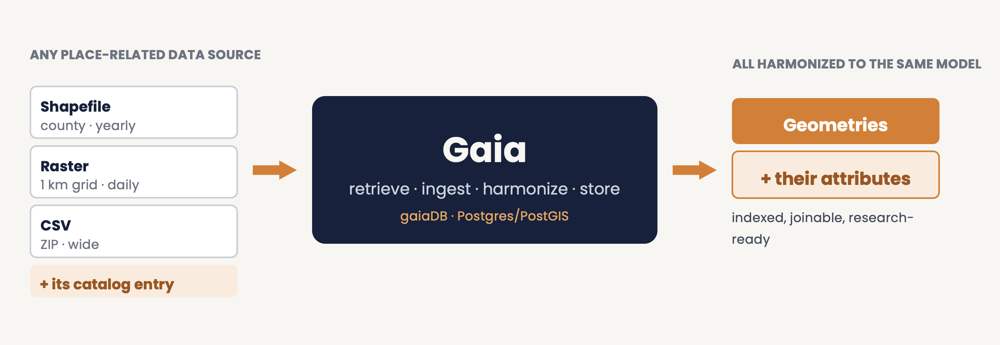
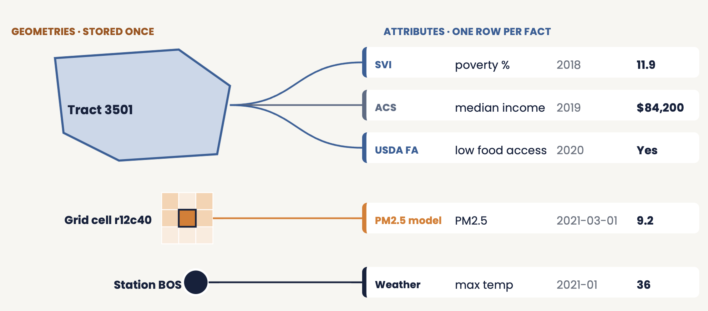
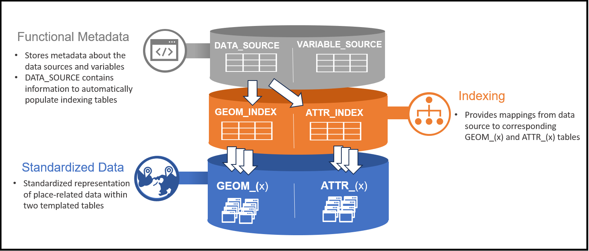

<br>

# **Design Rationale**

<br>

## Use Case Requirements

The Gaia toolchain was designed to meet specific research requirements for integrating geospatial data with patient health data:

**Research Goals**:
- Link patient locations to environmental and social exposures over time
- Harmonize disparate geospatial datasets from multiple sources
- Calculate spatiotemporal exposure metrics while preserving patient privacy
- Enable reproducible, federated network studies
- Support diverse spatial data types (the geometry-attribute index is implemented for vector geometries today; rasters can be staged, and full raster support is planned)

**Technical Requirements**:
- Standardized representation for heterogeneous geospatial data
- Automated retrieval and ingestion of external datasets
- Efficient storage and query performance for large spatial datasets
- Extensible architecture supporting community growth
- Integration with OMOP CDM and HADES analytics tools

<br>

## Core Design Goals

The foundational goals driving Gaia's architecture:

### **Extensibility**
- **Common data model** enables stable tooling development
- **Collaborative growth** through a shared metadata repository (the catalog)
- **Ontology integration** via OMOP vocabulary standards
- **Language-agnostic access** through database connections and an optional PostgREST API

### **Automation**
- **Data retrieval** from external sources, driven by each catalog entry's metadata and ETL scripts
- **Standardization** of every source into the same geometry and attribute structure
- **Ingestion** into the harmonized schema with one call per dataset
- **Deployment** via a containerized stack (gaiaDocker), or on any PostgreSQL/PostGIS server

### **Efficiency**
- **Storage design**: one geometry table and one attribute table per source, in a tall (one row per fact) layout
- **Spatial indexing** for query performance
- **Centralized metadata** reduces duplication of ETL effort
- **Modular architecture** allows independent component development

<br>

---

# **Architecture Strategy**

<br>

## Design Approach

| Challenge | Approach |
| :-------- | :------- |
| Enable extensible tooling | Implement a common data model for place-related data |
| Universal representation for any geospatial data | Represent data as geometries and attributes (of geometries) |
| Efficiency with large standardized datasets | Split each data source into its own pair of geometry and attribute tables |
| Static functionality for any new data | A geometry-attribute index (`geom_index`, `attr_index`) lets one join serve every source |
| Maintain source provenance and versioning | Data source and variable metadata with unique identifiers referenced throughout the schema |
| Automate retrieval, ingestion, standardization | Each catalog entry carries its metadata (JSON-LD) and ETL scripts; gaiaDB runs them |
| Enable collaborative metadata growth | Host metadata centrally (gaiaCatalog), not the data sources themselves |

<br>



*Whatever format a source arrives in, Gaia retrieves it using its catalog entry, ingests it, harmonizes it and stores it as geometries and their attributes.*

<br>

## Geometries and Attributes

Every source, whatever its native format, resolution or time coverage, is stored as one of two kinds of object: a **place** (a geometry) or a **fact about a place at a time** (an attribute).


Geometries are stored once, and any number of sources can attach facts to the same place:



*Two sources at the same level (for example SVI and ACS for one tract) do not add a new place, only new facts about the place that is already there.*

<br>

## Data Pipeline

Gaia processes geospatial data through a standardized pipeline:

```
External data source
    ↓
gaiaCatalog entry (JSON-LD metadata + ETL scripts)
    ↓  backbone.ingest_datasource()
gaiaDB: metadata load → download and load into PostGIS → geometry clean-up
    ↓  backbone.gdsc_load_all_variables()
working.geom_<source> and working.attr_<source>, registered in geom_index / attr_index
    ↓  working.spatial_join_from_catalog()
working.external_exposure
    ↓  gaiaCore (direct database connection)
OMOP CDM (EXTERNAL_EXPOSURE) + HADES analytics
```

**Pipeline stages**:

1. **Discovery**: gaiaCatalog holds metadata and ETL scripts for external datasets
2. **Metadata load**: the entry's JSON-LD populates `data_source` and `variable_source` and registers the dataset in the indexes
3. **Retrieval and ingestion**: the entry's ETL scripts download the source and load it into PostGIS (`ogr2ogr`), then clean the geometry and add a local-projection column
4. **Load variables**: `gdsc_load_all_variables` builds the dataset's `geom_*` and `attr_*` tables, one row per feature, variable and time window
5. **Join**: `spatial_join_from_catalog` matches person locations to geometries and clips each value to the residence interval, one variable at a time
6. **Access**: gaiaCore runs the pipeline from R, checks the derived rows and copies the exposure into the OMOP CDM

See the [gaiaDB README](https://github.com/OHDSI/gaiaDB) for the function reference.

<br>

---

# **Backbone Schema**

<br>

## Schema Overview

The gaiaDB `backbone` schema holds the metadata and the index; the per-source data tables live in the `working` schema.



*Metadata tables describe what data exists. Index tables map each source to its tables. Standardized tables hold the harmonized data.*

### **1. Metadata Tables**

**DATA_SOURCE** and **VARIABLE_SOURCE** are loaded from a catalog entry's JSON-LD file:

- **DATA_SOURCE**: one row per dataset. Columns include `dataset_id`, `dataset_name`, `dataset_version`, `description`, `creator`, `provider`, `license`, `spatial_coverage`, `geom_type`, `srid`, and the dataset's ETL metadata (`etl_metadata`).
- **VARIABLE_SOURCE**: one row per variable of a dataset. Columns include `variable_name`, `variable_description`, `property_id` (the variable's concept), `data_type`, `unit_code`, `unit_text`, `min_value`, `max_value`, `start_date` and `end_date`. The `variable_source_id` is what Gaia writes into `exposure_source_value`.

### **2. Index Tables**

**GEOM_INDEX** and **ATTR_INDEX** map each source to the tables that hold it:

- **GEOM_INDEX**: where each geometry table lives (`database_schema`, `table_name`) and its geometry type
- **ATTR_INDEX**: where each attribute table lives, plus the variable's name, concept, unit (`unit_source_value`) and time window (`attr_start_date`, `attr_end_date`)

The joins run against the tables these indexes describe, rather than against source-specific code, so a new source is added by cataloging it, not by writing a new join.

*Known limitation: the link from a geometry table back to its data source is still partly by table name; stable, load-order-independent identifiers are under discussion in the working group.*

### **3. Standardized Place-Related Data**

**GEOM_*{x}*** and **ATTR_*{x}*** tables hold the harmonized data:

- Each data source gets its own pair, created from two template tables
- All follow the same structure
- Spatial indexes are created on the geometry columns

<br>

---

# **Standardized Data Storage**

<br>

## Common Data Model Rationale

The common data model approach, proven for clinical data (OMOP CDM), provides:

1. **Interoperability**: harmonized structure enables federated research
2. **Extensibility**: a static model supports stable tooling development
3. **Scalability**: new data sources fit the existing structure

**Gaia's approach**: represent geospatial data as **geometry objects with affiliated temporal attributes**.

**Key transformation**: wide tables (one column per variable) become tall tables (one row per fact):

```
Wide format:
| geom_id | county_name | pop_2020 | income_median | svi_score |

Tall format:
| geom_id | variable       | value | start_date | end_date   |
| 001     | pop_2020       | 50000 | 2020-01-01 | 2020-12-31 |
| 001     | income_median  | 65000 | 2020-01-01 | 2020-12-31 |
| 001     | svi_score      | 0.45  | 2020-01-01 | 2020-12-31 |
```

Time series stored as JSON in a source column (for example the CDC monthly PM2.5 series) become one row per time window.

**Benefits**:
- A single standard representation for all attributes
- A static column structure across all data sources
- Efficient querying via the indexes
- New variables are added without changing the schema

<br>

## GEOM and ATTR tables

Two template tables, `backbone.geom_template` and `backbone.attr_template`, are replicated for every data source as `working.geom_<table_id>` and `working.attr_<table_id>`.

### Geometry table

| Column | Meaning |
| :----- | :------ |
| `geom_record_id` | Identifier of the geometry (the raw table's primary key) |
| `geom_name` | Human-readable name (for example a county name) |
| `geom_source_coding`, `geom_source_value` | How the source identifies the geometry (for example FIPS) |
| `geom_wgs84` | The geometry in WGS 84 (EPSG:4326) |
| `geom_local_epsg`, `geom_local_value` | The geometry in a local projection, used for measurement |
| `properties` | Remaining source columns |

*Hierarchies between geometries (for example tract within county) and validity periods for boundaries that change over time are not implemented yet; they are on the working group's list.*

### Attribute table

| Column | Meaning |
| :----- | :------ |
| `attr_record_id` | Identifier of the attribute row |
| `geom_record_id` | The geometry the fact is about |
| `variable_source_id` | The variable (links to `variable_source`) |
| `attr_concept_id` | The variable's concept |
| `attr_start_date`, `attr_end_date` | The time window the value applies to |
| `value_as_number`, `value_as_string`, `value_as_concept_id` | The value |
| `unit_concept_id`, `unit_source_value` | The unit, as declared in the catalog |
| `attr_source_value`, `value_source_value` | What the source file called the variable and the value |

<br>

---

# **Catalog Entries and Functional Metadata**

<br>

A catalog entry holds everything needed to retrieve and load one dataset. Besides the descriptive metadata that makes a dataset findable, it carries **functional metadata**: machine-actionable instructions that gaiaDB acts on.

## What a catalog entry contains

```
datastore/data/<table_id>/
  meta_json-ld_<table_id>.json     JSON-LD metadata (dataset and variables)
  meta_etl_<table_id>.json         ETL configuration (geometry, EPSG, fields)
  meta_dcat_<table_id>.json        DCAT catalog metadata
  etl/
    <table_id>_osgeo.sh            download the source and load it with ogr2ogr
    <table_id>_postgis.sh          clean the geometry, add a local projection, index
```

The JSON-LD file drives the metadata load:

| JSON-LD field | gaiaDB column |
| :------------ | :------------ |
| `@id` | `data_source.dataset_id` |
| `name` | `data_source.dataset_name` |
| `measurementTechnique` (vector geometry) | `data_source.geom_type` |
| `additionalProperty` (spatial reference system) | `data_source.srid` |
| `about` | `data_source.etl_metadata` |
| `variableMeasured[].propertyID` | `variable_source.property_id` and `attr_concept_id` |
| `variableMeasured[].startDate`, `endDate` | `variable_source.start_date`, `end_date` and the time window in `attr_index` |

The two shell scripts are the retrieval and transformation logic for that source. They are generated from the entry's metadata, not written by hand for each dataset.

## Why a central catalog

**Without functional metadata**: manual download of each dataset, custom transformation code for each source, undocumented ETL, duplicated effort across sites.

**With functional metadata**: retrieval from the source URL, a standard transformation, a documented and reproducible pipeline, and ETL logic shared across the community.

Functional metadata is hosted centrally in **gaiaCatalog**, not the datasets themselves, so storage is light, there is a single source of truth for each source, and any Gaia instance can ingest a dataset from its entry.

## How an entry is created

1. **Identify** a publicly hosted geospatial dataset and judge its fitness for the question ([Exercise 1](tutorial-exercise-1.html))
2. **Describe** it in the Kobo authoring form; the crosswalk turns the form into the JSON-LD record and the ETL scripts
3. **Test** it in a local stack with `backbone.ingest_datasource('<table_id>')`
4. **Submit** the entry to gaiaCatalog by pull request
5. **Review** by the working group, then merge

See [gaiaCatalog](gaiaCatalog.html) and [Get Started](get-started.html#propose-a-use-case) for more.

## Status of declarative recipes

The original design called for **recipes**: declarative metadata (`geom_spec` for geometries, `attr_spec` for attributes) that gaiaDB would read and execute directly. That is **not implemented**. Today, retrieval and loading run as source-specific ETL scripts, as above. How recipes should be expressed, and where they should be interpreted, is an open question the working group is evaluating before committing to an approach.

<br>

---

# **Design Benefits**

<br>

## Reproducibility

- **Version-controlled catalog entries**: metadata and ETL scripts tracked in git
- **Documented provenance**: source URLs, versions, and the variable behind every exposure row
- **Containerized deployment**: identical environments via gaiaDocker (a convenience, not a requirement)
- **Standardized vocabularies**: OMOP concepts for semantic interoperability

## Scalability

- **Efficient storage**: tall structure with indexing
- **Independent sources**: each source has its own tables
- **Portable**: gaiaDB is a standard PostgreSQL/PostGIS database that runs on any native Postgres server
- **Scaling**: spatial processing stays in gaiaDB; R sessions connect to it as needed

## Community Growth

- **Shared metadata**: reduces duplication of effort
- **Collaborative validation**: the community reviews catalog entries
- **Extensible architecture**: new data sources fit the existing structure
- **Open source**: all tools and metadata are freely available

<br>

---

# **Learn More**

- **[Gaia Overview](gaia-intro.html)**: Introduction to the Gaia toolchain
- **[Architecture](developer-architecture.html)**: Technical architecture and data flows
- **[Vocabulary](vocabulary.html)**: OMOP GIS vocabulary package
- **[Get Started](get-started.html)**: Deploy Gaia and join the working group

<br>
