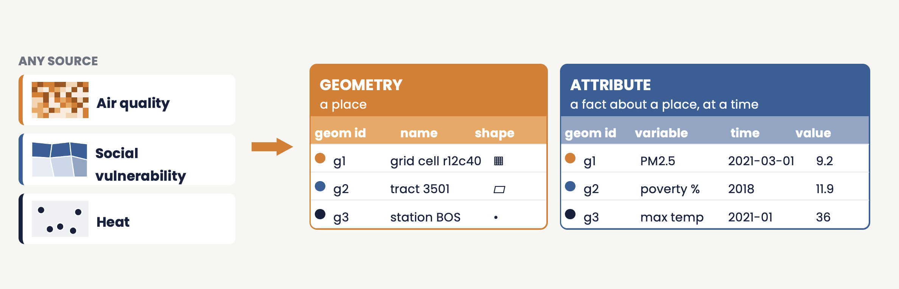

# **gaiaDB**

## Description

gaiaDB is the **core data repository** for the Gaia toolchain, implemented as a PostgreSQL/PostGIS database (a Docker image built on `postgis/postgis`). It holds the schema and the SQL function library that ingest catalogued datasets, register them in a common index, and join them to person locations to produce exposure rows for the OMOP `EXTERNAL_EXPOSURE` table.

## Key Features

- **PostgreSQL/PostGIS backend** for spatial data storage and operations
- **Geometry-attribute index**: every source, whatever its native format, resolution or time coverage, is registered the same way (`geom_index` for geometries, `attr_index` for attributes), so one join serves all of them and a new source is added by cataloging it
- **Catalog-driven ingestion**: `backbone.ingest_datasource('<table_id>')` loads a catalog entry's JSON-LD metadata, runs its ETL scripts and cleans the geometry
- **Spatial-temporal join** with `working.spatial_join_from_catalog`: point in polygon for where, interval overlap for when, with each value clipped to the residence interval
- **OMOP CDM integration** via the External_Exposure and Location_History tables
- **Direct connections** from R through gaiaCore, and an optional PostgREST API deployed by gaiaDocker

## Architecture

| Schema | Purpose |
|--------|---------|
| `backbone` | Metadata and index tables (`data_source`, `variable_source`, `geom_index`, `attr_index`), the two templates, and the ingestion and catalog functions |
| `working` | `location` and `location_history`, the per-dataset `geom_<table_id>` and `attr_<table_id>` tables, and the `external_exposure` output table |
| `vocabulary` | OMOP vocabulary tables |
| `public` | Raw source tables loaded by each dataset's ETL scripts |

All data transformation, spatial operations and exposure calculations are performed inside the database with SQL and PostGIS functions. See [Design Principles](gaia-principles.html) for the schema in detail.

## Main functions

| Step | Function |
|------|----------|
| Ingest a dataset | `backbone.ingest_datasource(table_id)` (metadata load, ETL scripts, geometry clean-up) |
| Build per-variable tables | `backbone.gdsc_load_all_variables(table_id, geom_label, ...)` |
| Load locations | `working.load_location_csv`, `working.load_location_history_csv` (or gaiaCore's `loadLocations()` / `loadLocationsFromOmop()`) |
| Check locations | `working.validate_location_data()`, `working.location_statistics()` |
| Join | `working.spatial_join_from_catalog(variable, table_id, ...)`, `working.spatial_join_all_from_catalog(table_id)` |
| Inspect or reset | `working.exposure_statistics()`, `working.clear_exposure_data(variable)` |

The full function reference is in the [repository README](https://github.com/OHDSI/gaiaDB).

## Scope and performance

- The geometry-attribute index covers **vector** geometries today. Raster sources can be staged, but registering them in the index is planned.
- Ingestion currently runs as source-specific ETL scripts generated from each catalog entry. A declarative recipe layer is being evaluated by the working group.
- The catalog-driven join is somewhat slower than an equivalent hand-written PostGIS query and returns identical rows; its value is provenance, standardization and reuse, not speed.

## Access

gaiaDB is accessed through:
- **gaiaCore**: R package that connects directly and calls the database's functions
- **Direct database connections**: standard PostgreSQL clients
- **PostgREST API** (optional): RESTful interface to database functions and tables, deployed by gaiaDocker

gaiaDB is a standard PostgreSQL/PostGIS database, so it also runs on any native Postgres server; Docker is a convenience, not a requirement.

## Documentation

- [Repository](https://github.com/OHDSI/gaiaDB)
- [Design Principles](gaia-principles.html)
- [Deployment via gaiaDocker](developer-deployment.html)
