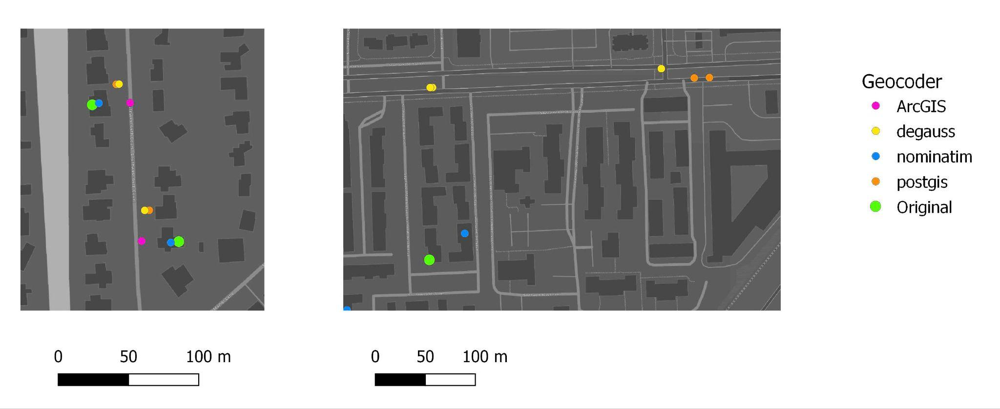

# **Geocoding Guidance**

Geocoding assigns spatial coordinates to location information such as address strings or place names. The GIS toolchain needs patient locations as coordinates (or as a geography such as a tract or ZIP code) with dates, but the working group does not develop geocoding software. This page summarizes the options, how four geocoders compared on the same addresses, and what to consider before choosing one.

Geocoding is optional and sits outside the Gaia core. A site that already holds ZIP codes or census tracts can start from those; the [Gaia overview](gaia-intro.html#what-you-need) describes the coarser-to-finer options.

<br>

## **Methods and what they depend on**

| Process or method | Dependencies | Geocoders |
|---|---|---|
| Parcel-based geocoding | A building parcel layer | Nominatim, ArcGIS |
| Interpolation-based geocoding (U.S. addresses only) | Roadway network; road-segment address ranges | PostGIS, DeGAUSS, ArcGIS |
| ZIP-code geocoding | ZIP/postal code polygons; ZCTA crosswalk (ZIP to tract, ZIP to county) | DeGAUSS, ArcGIS |
| City or administrative-unit geocoding | Access to a gazetteer API | |
| Field observations | GPS receiver (device calibration) | |

<br>

## **The four geocoders compared**

DeGAUSS and the PostGIS TIGER geocoder are available as optional components of the Gaia Docker deployment. OpenStreetMap Nominatim has been used as an alternate geocoder in prior deployments but is not part of the default containerized stack. ArcGIS Pro is a commercial comparator and is not part of the toolchain.

| Geocoder | Match score | Match CRS | Results | Depends on census vintage | Size for USA deployment |
|---|---|---|---|---|---|
| PostGIS TIGER | 0 (good) to 100 (bad) | NAD83 | single | yes | about 233 GB |
| DeGAUSS | 0 (bad) to 1 (good); precision as range, street, intersection, zip, city | NAD83 | multiple | yes | about 10 GB |
| ArcGIS Pro | 0 (bad) to 100 (good); precision as address type | WGS84 | single | no | about 53 GB |
| Nominatim | no match score | WGS84 | multiple | no | about 335 GB |

PostGIS TIGER and DeGAUSS use U.S. reference data and cover U.S. addresses only. Nominatim also provides global coverage, which matters for international multi-site studies.

<br>

## **Benchmark**

We benchmarked the four geocoders on 5,000 validated residential addresses in Miami-Dade County, Florida, with known true locations (the county property-parcel point for each address). Metrics were hit rate, the distribution of error distances by distance band, and the median, mean and maximum error. DeGAUSS, PostGIS TIGER and Nominatim can run locally, so no address data leaves the institutional compute environment. ArcGIS Pro was run with an enterprise license and the Esri StreetMap Premium database; addresses are sent to Esri servers in the University of Miami configuration, so it is used only as a comparator and is not part of the privacy-preserving stack. The protocol recorded geocoder versions, reference-data snapshot dates, the address sampling frame, preprocessing rules and hardware.

| Geocoder | Geocoded (hit rate) | 0-100 ft | 100-500 ft | 500 ft-1 mi | > 1 mi | Median ft (m) | Mean ft | Max ft |
|---|---|---|---|---|---|---|---|---|
| PostGIS TIGER | 4,999 (99.98%) | 1,675 | 2,400 | 711 | 213 | 155 (47) | 3,934 | 2,700,504 |
| DeGAUSS | 4,960 (99.20%) | 1,420 | 2,583 | 766 | 191 | 165 (50) | 818 | 57,698 |
| ArcGIS Pro | 4,868 (97.36%) | 2,985 | 1,789 | 87 | 7 | 85 (26) | 284 | 212,687 |
| Nominatim | 4,918 (98.36%) | 3,718 | 899 | 230 | 71 | 18 (5.6) | 303 | 57,096 |

Median error was smallest for Nominatim and ArcGIS Pro. PostGIS TIGER and DeGAUSS had the heaviest tails, and PostGIS TIGER produced a few extreme outliers (maximum about 510 miles). Address preprocessing (standardizing directional abbreviations, street suffixes and unit designators) improved match rates by 8-12% across services.



*Two example addresses: the green point is the original location, the others are each geocoder's result.*

The error distributions come from one urban county, so rural error is probably understated. How much geocoding error matters for an effect estimate depends on how fast the exposure varies in space; see the [evaluation](evaluation.html) page.

<br>

## **An example workflow with DeGAUSS**

1. **Prepare addresses**: standardize for the geocoder's input (for example USPS Publication 28 for DeGAUSS) and check the parsed address fields
2. **Geocode**, keeping quality flags
3. **Review the output**: spatial coordinates and accuracy metrics
4. **Quality control**: completeness, conformance and plausibility
5. **Accept** geocodes for the analyses needed

One address through the workflow:

```
Where and when:     1410 NE Campus Pkwy, Seattle, WA 98195

Geocoding input:    {'location_id': 1, 'Addr1': '1410 NE Campus Pkwy', 'Addr2': '',
                     'City': 'Seattle', 'State': 'WA', 'Zip': '98195'}

Geocoding output:   {'location_id': 1, 'Lat': '47.6567171', 'Lng': '-122.3066182',
                     'Match_score': '0.8', 'Precision': 'range', 'geocode_result': 'geocoded'}
```

Accuracy considerations: whether the match is interpolated or parcel-based, the spatial unit of the analysis (tract, city), address review and correction, and positional error where ground truth exists.

<br>

## **Privacy and cybersecurity considerations**

- **Software and middleware**: information security and dependency vulnerabilities
- **Client-server architecture**: query logging, IP address logging, whether the geocoder runs inside the enclave or needs internet API calls, and query speed
- **Data flow**: encryption, retention in external systems, and deletion clauses

Local geocoding supports privacy-preserving deployment, but compliance depends on institutional governance, configuration and data-flow controls. Residential addresses and location histories are personal data under the GDPR, and fine-grained coordinates can act as quasi-identifiers; sites in the EU should complete the appropriate data-protection assessments.

Geocoding accuracy and bias also vary by address type and population: rural addresses geocode less accurately than urban ones, and addresses for people experiencing homelessness or in non-traditional housing may be incomplete or missing from reference data. These errors are socially patterned and may amplify, rather than randomize, exposure misclassification.

<br>

## **More**

- Benchmark data: [geocode-benchmark-2023](https://github.com/tibbben/geocode-benchmark-2023)
- Roadmap: [Geocoding](https://github.com/OHDSI/GIS/issues/366)

<br>
