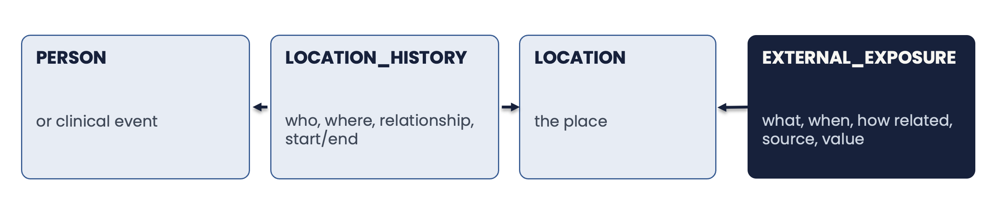

```{r setup, include=FALSE, eval=TRUE}

library(rmarkdown)
library(knitr)
library(kableExtra)
library(magrittr)
library(dplyr)
library(readr)
library(stringr)

```

```{css zoom-lib-src, echo = FALSE}
script src = "https://ajax.googleapis.com/ajax/libs/jquery/3.4.1/jquery.min.js"
```

```{js zoom-jquery, echo = FALSE}
 $(document).ready(function() {
    $('body').prepend('<div class=\"zoomDiv\"></div>');
    // onClick function for all plots (img's)
    $('img:not(.zoomImg)').click(function() {
      $('.zoomImg').attr('src', $(this).attr('src')).css({width: '100%'});
      $('.zoomDiv').css({opacity: '1', width: 'auto', border: '1px solid white', borderRadius: '5px', position: 'fixed', top: '50%', left: '50%', marginRight: '-50%', transform: 'translate(-50%, -50%)', boxShadow: '0px 0px 50px #888888', zIndex: '50', overflow: 'auto', maxHeight: '100%'});
    });
    // onClick function for zoomImg
    $('img.zoomImg').click(function() {
      $('.zoomDiv').css({opacity: '0', width: '0%'}); 
    });
  });
```

# **OMOP GIS Schema Extensions**

](images/slides/omop_gis_extension_tables.png){width=150%}
<br>

*Both tables hang off the person, like any other OMOP clinical table. `entity_id` is the `person_id` when the domain is Person. Bold fields are required; blue fields hold standard concepts (GIS, Exposome, SDoH).*

<br>

## **Overview**

The OMOP GIS Vocabulary Package extends the OMOP Common Data Model (CDM) to support geospatially-linked health determinants and environmental exposures. This extension is anchored by the **external_exposure** table, which serves as the foundational structure enabling integration of spatial, environmental, and sociodemographic data into observational health research workflows.

## **The person-place-time bridge**



Standard concepts carry the meaning of each exposure row; Gaia's catalog carries its provenance (`exposure_source_value` holds the `variable_source_id` of the variable the row came from).

<br>

## **Source-to-concept navigation map**

| Component | Question answered | Standard | Destination field |
|---|---|---|---|
| Exposure variable | What contextual attribute was assigned? | OMOP SDoH, OMOP Exposome, or an existing standard concept in OHDSI Athena | `exposure_concept_id` |
| Exposure derivation/type | How was the record generated, or what source class produced it? | Type Concept / GIS Exposure Type concept | `exposure_type_concept_id` |
| Spatial relationship | How did the person-location geometry relate to the source geometry? | OMOP GIS geometry relationship | `exposure_relationship_concept_id` |
| Source provenance | Which named dataset or source supplied the variable? | Source concept identifier when available, plus source value | `exposure_source_concept_id`, `exposure_source_value` |
| Numeric result | What number was assigned? | No concept; numeric value | `value_as_number` |
| Categorical result | What standardized category was assigned? | Standard value concept from GIS vocabularies or Athena | `value_as_concept_id` |
| Unit | In what unit is the value expressed? | Standard unit concept | `unit_concept_id` |
| Location interval | Where and during what period was the entity located? | GIS relationship/type concepts plus OMOP location linkage | `LOCATION_HISTORY` |
| Source variable code | What did the original file call the variable? | Retained for traceability, not assumed to be standard | `exposure_source_value` |

*A worked example for PM2.5: `exposure_concept_id` 2052499839 (what was measured), `exposure_type_concept_id` 2052499878 (Air Quality Database, the kind of data source), `exposure_relationship_concept_id` 2052496943 (Within, how person and place were linked), `exposure_source_value` the variable's `variable_source_id`, and the unit micrograms per cubic meter (concept 32964) as declared in the catalog. Gaia-derived rows currently leave `unit_concept_id` empty.*

<br>

```{r docLoopGaia, echo=FALSE, results='asis'}

tableSpecs <- readr::read_csv("../inst/csv/Gaia_Table_Level.csv", show_col_types = FALSE)
cdmSpecs <- readr::read_csv("../inst/csv/Gaia_Field_Level.csv", show_col_types = FALSE)

tables <- tableSpecs$cdmTableName

gaiaSpecsClean <- cdmSpecs %>%
  dplyr::select(`Gaia Table` = cdmTableName,
                `Gaia Field` = cdmFieldName,
                `User Guide` = userGuidance,
                `ETL Conventions` = etlConventions,
                `Datatype` = cdmDatatype,
                `Required` = isRequired,
                `Primary Key` = isPrimaryKey,
                `Foreign Key` = isForeignKey,
                `FK Table` = fkTableName,
                `FK Domain` = fkDomain
                )

gaiaSpecsClean[is.na(gaiaSpecsClean)] <- ""

for(tb in tables) {

  cat("##", tb, "{.tabset .tabset-pills} \n\n")

  cat("Access DDL scripts [here](https://github.com/OHDSI/GIS/tree/main/inst/ddl/)\n\n")

  tableInfo <- subset(tableSpecs, cdmTableName == tb)
  cat("**Table Description**\n\n", tableInfo$tableDescription[1], "\n\n")

  # Get table-level user guidance and ETL conventions if they exist
  if(nrow(tableInfo) > 0 && !is.na(tableInfo$userGuidance[1]) && tableInfo$userGuidance[1] != ""){
    cat("**User Guide**\n\n", tableInfo$userGuidance[1], "\n\n")
  }

  if(nrow(tableInfo) > 0 && !is.na(tableInfo$etlConventions[1]) && tableInfo$etlConventions[1] != ""){
    cat("**ETL Conventions**\n\n", tableInfo$etlConventions[1], "\n\n")
  }

  loopTable <- subset(gaiaSpecsClean, `Gaia Table` == tb)
  loopTable <- subset(loopTable, select = -c(1))

  cat(knitr::kable(x = loopTable, align = "l", row.names = FALSE, format = "html", escape = FALSE) %>%
           column_spec(1, bold = T) %>%
           # column_spec(2, width = "3in", include_thead = T) %>%
           # column_spec(3, width = "4in", include_thead = T) %>%
           # column_spec(4:9, width = "1in", include_thead = T) %>%
           kable_styling(c("condensed","hover"), position = "center", full_width = T, font_size = 13))

  }
```

<br>

```{r child="sections/6_cdm_extensions.Rmd"}
```